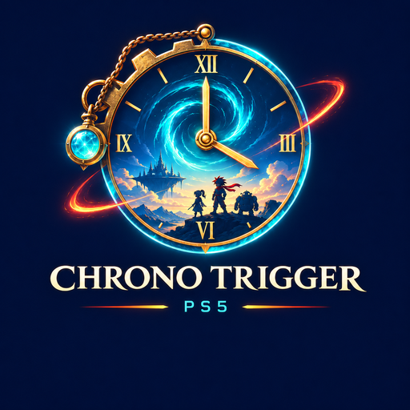

# CTPS5

Native PS5 homebrew port of **Chrono Trigger for Nintendo DS (USA)**, based on **[Egg of Time](https://github.com/power-pudu/egg-of-time) by Power Pudu**. The original PC project supplies the static recompiler and game runtime. This repository adds the PS5 platform integration and presentation changes.

**[Project website](https://savageforengland-hue.github.io/chrono-trigger-PS5/) · [Build](docs/BUILDING.md) · [Install](docs/INSTALLING.md) · [Controls](docs/CONTROLS.md) · [Credits](docs/CREDITS.md)**

> **Feature branch:** optional [portrait battle HUD replacement preview 2](docs/PORTRAIT-HUD.md). Uses menu faces from your own ROM to replace the normal HP/MP/ATB panel; gameplay keeps its size and selection screens remain usable. This candidate still needs PS5 battle testing.

## Release status

**0.1.0-rc3 — release candidate, 14 November 2026.** Earlier PS5 builds reached gameplay and audio on the target console. The candidate includes native scanout fixes, a direct-memory heap, DualSense prompts and adaptive widescreen presentation. RC2 restored room-boundary clipping and removed blurred scene-edge side copies after an RC1 regression report. RC3 adds PS5 replacements for identified game-owned button sprites and instructions, using each player’s NDS data in memory. Fully relaunch after changing bindings to refresh in-game art. Console save/load, extended gameplay, the latest presentation changes and sustained 4K60 still need hardware validation. This is not a stable release.

This is the **Nintendo DS version**, not the PS1 version. Functions are translated to C and compiled ahead of time. The renderer uses a software framebuffer with native VideoOut. Output supports high resolutions; sustained 4K at 60 fps is a target, not a measured guarantee. See [release notes](docs/RELEASES.md).

## Build from your own game

You supply an unmodified USA YQUE `.nds` dump. [Build instructions](docs/BUILDING.md) cover the public SDK, pinned SDL source, extraction, recompilation and native packaging. The public download contains authored source, tools and documentation; **no ROM, extracted game assets, saves, generated game code or game executable**. Generated code and the statically linked game executable must remain local. See [distribution details](docs/DISTRIBUTION.md).

## Original PC project — Power Pudu

| Resource | Link |
| --- | --- |
| Original PC source | [power-pudu/egg-of-time](https://github.com/power-pudu/egg-of-time) |
| Original PC releases | [Egg of Time releases](https://github.com/power-pudu/egg-of-time/releases) |
| Exact source used | [v1.3.5 / d294c017](https://github.com/power-pudu/egg-of-time/tree/d294c017e53d137b3729bddcd120e0f7a2b82590) |
| Pristine source included | [Unmodified original source archive](upstream/egg-of-time-v1.3.5-source.tar.gz) |
| Original copyright and license | [Copyright 2026 Power Pudu — MIT](upstream/EGG-OF-TIME-LICENSE.md) |

The pristine upstream archive preserves the original PC README, source and notices. The modified runtime and recompiler live in `runtime/` and `tools/recomp/`. PS5 additions live in `ps5/`. [Credits](docs/CREDITS.md) distinguish the original project from the port.

## Documentation

- [Installation and updates](docs/INSTALLING.md)
- [DualSense controls and widescreen choices](docs/CONTROLS.md)
- [Texture packs and modular configuration](docs/MODS.md)
- [Logs and troubleshooting](docs/TROUBLESHOOTING.md)
- [Release status and validation](docs/RELEASES.md)
- [Licensing and third-party notices](LICENSING.md)
- [Contributing and reporting issues](CONTRIBUTING.md)
- [Publishing / previewing the GitHub Pages site](docs/PUBLISHING.md)

## Licenses

The combined PS5 distribution includes GPL-3.0-or-later components; see [LICENSE](LICENSE), [LICENSING.md](LICENSING.md) and component notices. Power Pudu's original code remains MIT licensed, with its notice preserved verbatim. SDL is under the zlib license; other component licenses remain in their source directories.

Unofficial fan project, not affiliated with or endorsed by Square Enix, Nintendo or Sony. Chrono Trigger and the associated game content belong to their respective owners.
